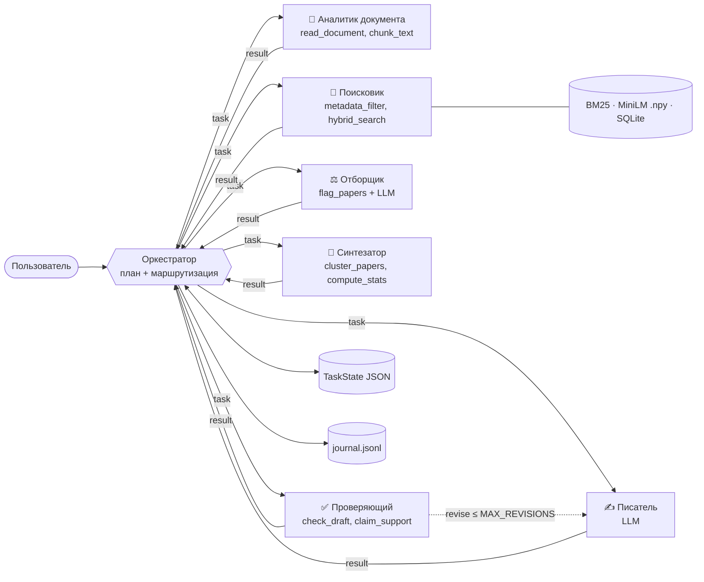

# ResearchAssist — многоагентный помощник для поиска и анализа научной литературы

Учебный проект в рамках магистерской диссертации «Разработка интеллектуального помощника для
сопровождения научно-исследовательской работы». Работает **локально и офлайн**: корпус arXiv
(20 000 статей), гибридный поиск BM25 + MiniLM, локальная LLM через Ollama (qwen2.5).

## Что делает система

Пользователь загружает статью или описание темы (TXT / DOCX / PDF). Система:

1. выделяет исследовательскую задачу, ключевые понятия и методы;
2. находит похожие работы в локальном корпусе arXiv (гибридный поиск);
3. отбирает работы, решающие **ту же задачу**, а не просто из той же области;
4. группирует их по подходам и находит пробелы;
5. пишет черновик раздела Related Work со ссылками `[n]` только на найденные статьи;
6. проверяет каждую ссылку и утверждение и при необходимости возвращает текст на доработку.

## Архитектура

Схема «оркестратор + общее состояние». Оркестратор только планирует (разбирает запрос: число статей,
годы, категории, фокус) и маршрутизирует типизированные сообщения `AgentMessage {sender, receiver, type, payload}`.
Состояние задачи — один pydantic-объект `TaskState`, сохраняется в `runs/<id>/state.json`.



| Агент | Инструменты (≤ 2) | Что решает код | Что решает LLM |
|---|---|---|---|
| Аналитик документа | `read_document`, `chunk_text` | чтение TXT/DOCX/PDF, фрагменты ~2 500 симв., ошибки входа | задача, ключевые слова, методы, «есть ли научная задача» |
| Поисковик | `metadata_filter`, `hybrid_search` | BM25 + косинус MiniLM, z-нормировка, `w = 0.8` на плотную часть; фильтр SQLite по годам/категориям | — |
| Отборщик | `flag_papers` | дубли, версии (`v1/v2`), похожие заголовки, те же авторы | «та же задача / нет» + обоснование |
| Синтезатор | `cluster_papers`, `compute_stats` | k-means (seed 42), статистика по годам/категориям/темам | названия тем, пробелы |
| Писатель | — | — | 2–4 абзаца со ссылками `[n]` |
| Проверяющий | `check_draft`, `claim_support` | ссылки ∈ отобранным, нет выдуманных, нет дублей, длина абзацев | оценки 1–5: подтверждённость, точность, полнота |

Если правило нарушено или оценка ≤ 2 — текст возвращается писателю (не больше `MAX_REVISIONS` кругов).

**LLM:** Ollama, `qwen2.5:7b` по умолчанию (`qwen2.5:3b` — для слабого ПК), `format=json`, `temperature=0.2`,
`seed=42`. Каждый ответ проверяется pydantic-схемой, при невалидном JSON — повтор. Модель не дообучается,
роли — zero-shot инструкции. Для каждого вызова есть детерминированная эвристика: она используется
в **офлайн-режиме** (без Ollama) и как изоляция сбоя, если все повторы исчерпаны.

**Надёжность:** лимит шагов (150), лимит времени (1 200 с), повторы при сбоях инструментов и LLM,
изоляция ошибок на уровне одной статьи, понятные сообщения об ошибках входа с подсказкой. При срабатывании
лимита частичное состояние сохраняется.

**Журнал:** каждый вызов LLM и инструмента пишется в `runs/<id>/journal.jsonl`
(время, агент, тип, длительность, токены, статус) — аудиторский след решений.

## Как запустить

Требуется Python 3.11–3.13; для LLM — [Ollama](https://ollama.com).

| | Windows | Linux / macOS |
|---|---|---|
| Установка (один раз) | `setup.bat` | `./setup.sh` |
| Запуск интерфейса | `run.bat` | `./run.sh` |

Установка создаёт `.venv`, ставит зависимости, скачивает `qwen2.5:7b` и `qwen2.5:3b`, корпус arXiv
и строит индексы (BM25, эмбеддинги MiniLM в `.npy`, SQLite). Интерфейс открывается на http://localhost:8501.

Docker (опционально): `docker compose up --build`, затем `docker compose exec ollama ollama pull qwen2.5:3b`.

Оценка и тесты:

```bash
python evaluate.py --llm offline        # быстро, детерминированно (без LLM)
python evaluate.py --llm auto --model qwen2.5:3b   # с локальной LLM (долго на CPU)
python -m pytest -q
```

## Структура репозитория

```
app/          интерфейс Streamlit (5 страниц), тема, экспорт MD/DOCX
agents/       шесть предметных агентов
core/         оркестратор, сообщения и состояние (pydantic), LLM-клиент, журнал, лимиты, ошибки
tools/        чтение документов, гибридный поиск, правила отборщика и проверяющего
data/         корпус arXiv и индексы (создаются prepare_data.py)
scenarios/    тестовые входные документы и их генератор
tests/        pytest на инструменты и правила проверяющего
results/      CSV / JSON / PNG оценки
runs/         состояние и журнал каждого прогона
evaluate.py   15 сценариев × 3 прогона + сравнение с «одним агентом»
```

## Оценка (`results/`)

* `scenarios_table.csv` — 15 сценариев (7 содержательных, 5 ошибок входа/окружения, 3 защиты), успешность;
* `runs.csv` — все 45 прогонов; `summary.json` — итоги (требование ≥ 90 % успешных, нагрузка ≤ 40 % на агента);
* `agent_load.csv/png` — доля вызовов LLM и инструментов по агентам;
* `critic_scores.csv/png` — оценки проверяющего по критериям;
* `baseline_runs.csv`, `baseline_comparison.csv/png` — многоагентная схема против одного агента
  (выдуманные ссылки, подтверждённые утверждения, число статей, дубли, покрытие тем, время, вызовы LLM);
* `time_by_scenario.png` — время по сценариям.

## Как показать преподавателю за 5 минут

1. `run.bat` → страница **Запуск**: пример «Гибридный поиск похожих статей (TXT)», 6 статей,
   включён тумблер «Замедлить анимацию» → **🚀 Запустить**.
2. **Ход работы**: подсвечивается активный агент, лента сообщений «кто → кому, тип, содержание»,
   счётчики шагов и времени. Если проверяющий вернул текст, появляется оранжевая дуга «Проверяющий → Писатель».
3. **Результаты**: карточка задачи → вкладка «Related Work» (ссылки `[n]` кликабельны, ведут на arXiv) →
   «Найденные статьи» (скор, решение отборщика, обоснование, пометки дублей/версий) → «Темы и пробелы» →
   «Проверка» (что исправлено при доработке). Скачать DOCX.
4. На **Запуске** выбрать «Неподдерживаемый формат (CSV)» или «Документ без научной задачи» — дружелюбная ошибка с подсказкой.
5. **Эксперименты**: таблица 15 сценариев, графики нагрузки и сравнения с одним агентом.
6. **Журнал**: фильтр по агенту — видно, какой агент, когда и на основании чего принял решение.

## Ограничения

* Корпус ограничен 20 000 аннотаций arXiv (2020–2024 и май 2026); полные тексты статей не используются.
* На CPU без GPU `qwen2.5:7b` отвечает медленно (десятки секунд на вызов); для показа удобнее `qwen2.5:3b`
  или офлайн-режим. В офлайн-режиме решения LLM заменены эвристиками — числа в `results/` помечены режимом.
* Оценка «подтверждается ли утверждение аннотацией» — по пересечению терминов и LLM-оценке, а не по
  экспертной разметке.
* Корпус англоязычный, поэтому лучше описывать тему на английском; черновик пишется на русском.

## Лицензия

MIT — см. `LICENSE`.
